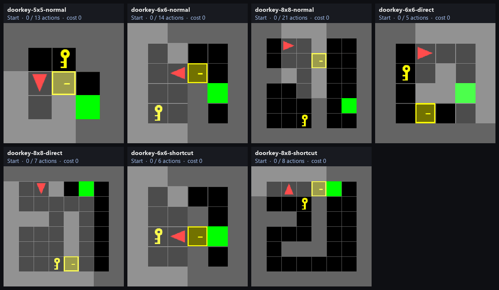
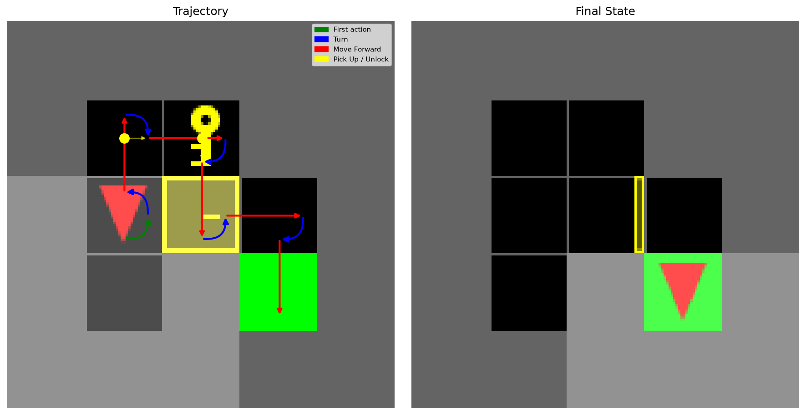
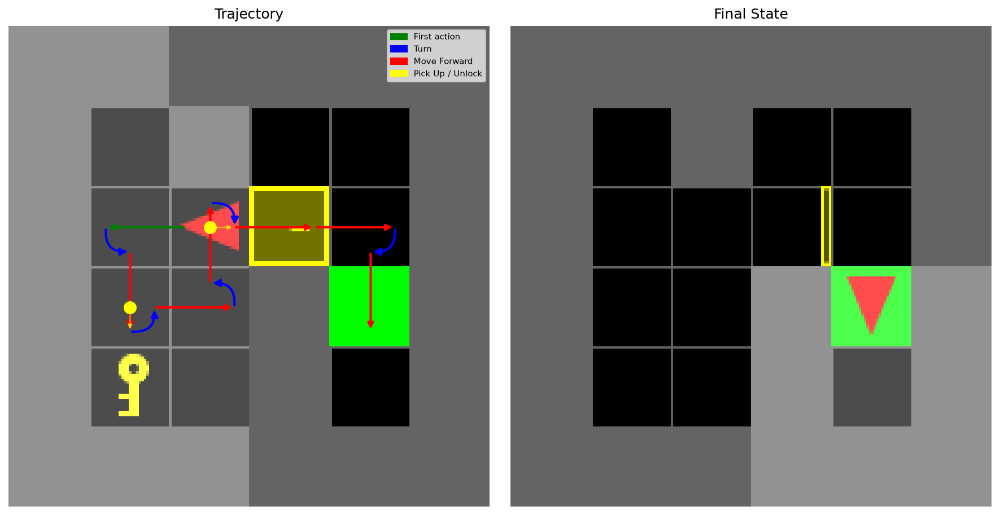
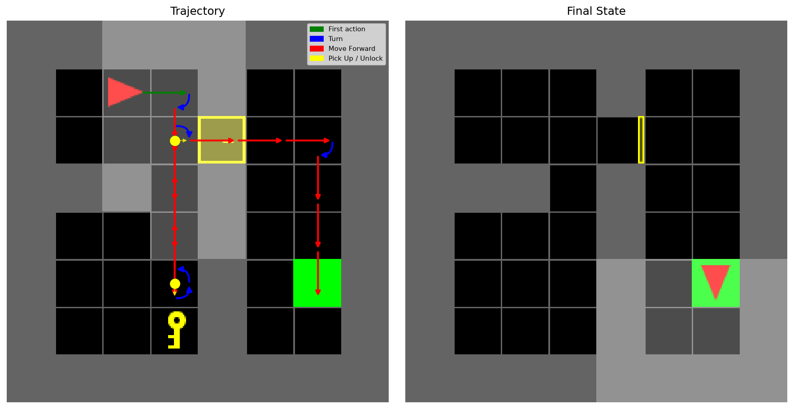
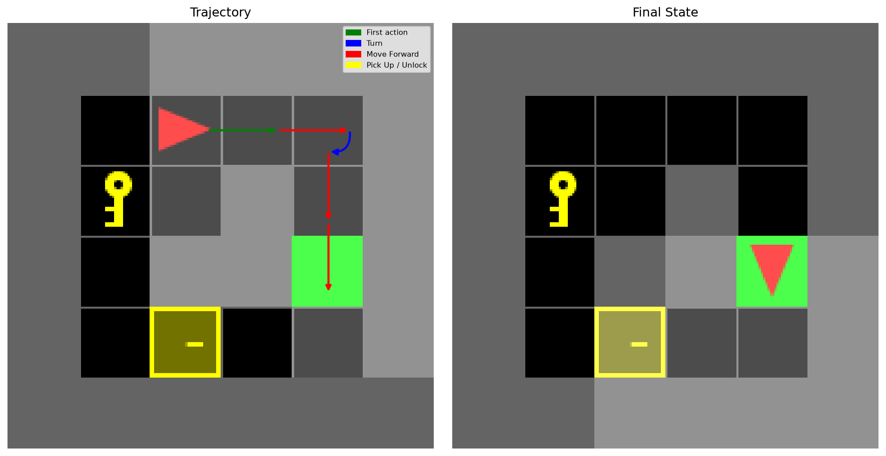
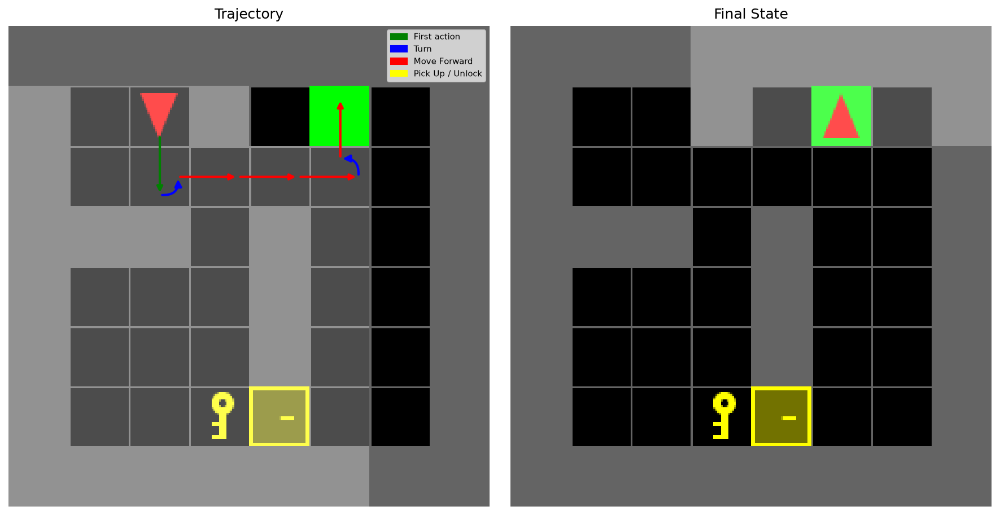
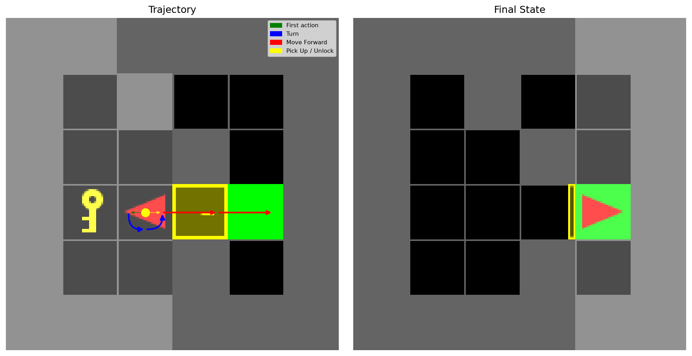
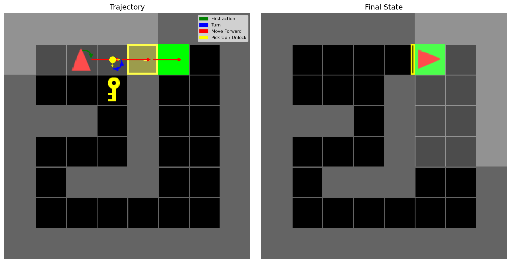
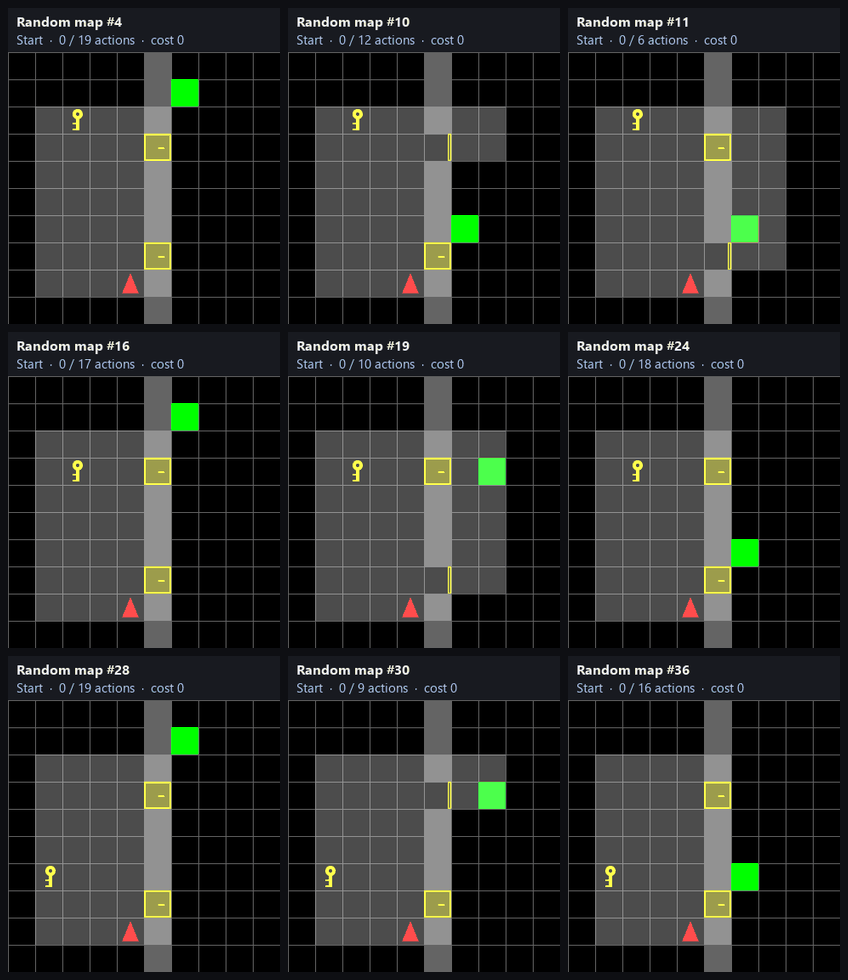
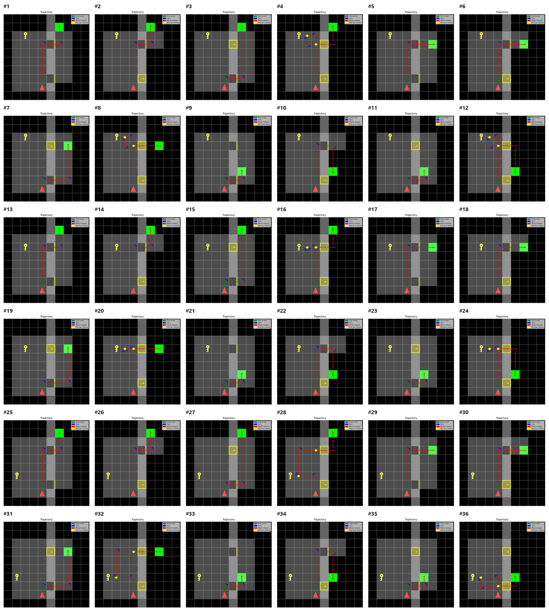

# Pathfinding with Dynamic Programming

**Optimal planning for the MiniGrid Door & Key problem**, solved exactly as a deterministic shortest-path problem with backward dynamic programming.

  

An agent in a grid world has to reach the green goal tile. Walls block it, its moves depend on which way it is facing, and a locked door may be in the way. To get through a locked door it has to find the key, pick it up, and unlock the door. Each action has a different cost, so the task is to reach the goal at **minimum total cost**, not just to reach it. Sometimes the cheapest plan skips the key entirely and walks around the door.

The planner always finds the optimal plan. On the 7 hand-designed maps it plans in **under 0.1 s**. A **single policy** covers all 36 randomized 10×10 maps and is computed once in a few seconds.

---

## How it works

**1. Model the problem as a deterministic MDP.** Each state stores everything the agent needs to choose its next action:

| State component | Values |
|---|---|
| Position `(x, y)` | every non-wall cell |
| Facing direction | N, E, S, W |
| Carrying key? | yes / no |
| Door(s) open? | per-door open / closed |
| *(random maps only)* map configuration | which of 3 key spots and 3 goal spots is active |

**2. Give the actions non-uniform costs.** The costs are loosely based on how much energy and effort each action takes:

| Action | Move Forward | Turn Left | Turn Right | Pick Up Key | Unlock Door |
|---|:-:|:-:|:-:|:-:|:-:|
| **Cost** | 3 | 1 | 1 | 2 | 5 |

Invalid actions, such as walking into a wall or reaching for a key that isn't there, leave the state unchanged but still cost the agent.

**3. Solve backwards from the goal.** Transitions are deterministic and every cost is positive, so the problem reduces to a **deterministic shortest path** over a graph whose vertices are states and whose edges are actions. Value iteration starts with every goal state at cost-to-go 0. Each sweep applies the Bellman update

$$V(x) \leftarrow \min_{u}\ \big[\ \ell(x,u) + V\big(f(x,u)\big)\ \big]$$

and stores the minimizing action as the policy. When a sweep changes nothing, `V` is the exact optimal cost-to-go from every state. At that point the plan is just "follow the policy from the start state."

**4. Keep the graph small.** Wall cells are never added as states. Only the key and door positions that can actually occur are enumerated, not every possible placement. This cuts the problem from roughly `O(n⁸)` to `O((n − w)⁴)` for an `n × n` grid with `w` wall cells.

---

## Results

### Known maps: one optimal plan per map

Each of the seven hand-designed maps gets its own planner. The animation at the top plays every optimal plan side by side. Red dots mark the path the agent has taken so far.

| Map | States | Actions | **Optimal cost** | Uses key? | Planning time |
|---|--:|--:|--:|:-:|--:|
| 5×5 normal   | 112 | 13 | **28** | ✅ | 7 ms  |
| 6×6 normal   | 208 | 14 | **33** | ✅ | 14 ms |
| 8×8 normal   | 464 | 21 | **54** | ✅ | 88 ms |
| 6×6 direct   | 208 |  5 | **13** | — | 15 ms |
| 8×8 direct   | 480 |  7 | **17** | — | 35 ms |
| 6×6 shortcut | 208 |  6 | **15** | ✅ | 19 ms |
| 8×8 shortcut | 448 |  8 | **19** | ✅ | 41 ms |

**What the plans show:**
- **Normal** maps: the door is the only way through, so the agent goes for the key first.
- **Direct** maps: a route around the door exists, and the planner takes it rather than paying to pick up the key and unlock the door.
- **Shortcut** maps: the key is only a step or two from the agent. Grabbing it and unlocking the door is cheaper than any detour.

<b>Full trajectory plots for each known map</b> (click to expand)

 

Arrow colors: **green** = first action, **blue** = turn, **red** = move forward, **yellow** = pick up key / unlock door. The left panel shows the full trajectory and the right panel shows the final state.

| | |
|:-:|:-:|
| **5×5 normal**    | **6×6 normal**    |
| **8×8 normal**    | **6×6 direct**    |
| **8×8 direct**    | **6×6 shortcut**    |
| **8×8 shortcut**    | |

Each map also has its own step-by-step animation in [`assets/known/`](assets/known).

### Random maps: one policy for every map

The 36 randomized 10×10 maps share a layout: a wall splits the grid in two, and it has two doors. They differ in where the key is (3 options), where the goal is (3 options), and which doors start open (4 combinations). Instead of re-planning for every map, the planner adds the map configuration to the state and solves **once**, over **26,496 states**, in a few seconds. After that, each new map is handled by a policy lookup that takes **under 1 ms**.

  

The policy changes its strategy depending on the map. When a door is open, it walks straight through. When both doors are locked, it detours for the key. It also picks whichever door gives the cheaper route to that map's goal.

**Optimal cost for every random configuration** (each cell covers 3 maps, one per key position):

| Doors initially open | Goal top `(6,1)` | Goal middle `(7,3)` | Goal bottom `(6,6)` |
|---|:-:|:-:|:-:|
| Both                 | 29 | 25 | 14 |
| Upper only           | 29 | 25 | 32 |
| Lower only           | 29 | 26 | 14 |
| **Neither** (key required) | 44 – 50 | 40 – 46 | 41 – 53 |

Key position only matters when both doors are locked. In every other case the optimal plan ignores the key entirely. Note the "upper only / goal bottom" cell: walking the long way through the open upper door (cost 32) is still cheaper than fetching the key to unlock the closer lower door.

<b>All 36 random-map trajectories</b> (click to expand)

 

Each map also has its own step-by-step animation in [`assets/random/`](assets/random).

---

## Takeaways

- **Exact, not approximate.** The problem is deterministic and all costs are positive, so plain dynamic programming gives *provably* optimal plans. No learning or heuristics are needed.
- **Most of the speed comes from choosing the state space carefully.** Leaving out wall cells and impossible key/door placements makes exact DP fast even on 10×10 maps with many possible configurations.
- **Precompute once, act instantly.** Folding the map configuration into the state turns 36 separate planning problems into a single offline solve, followed by near-instant execution.
- **Room to improve.** Invalid actions, like turning into a wall or reaching for a missing key, are still evaluated as edges in the graph. Pruning those self-loops would speed up the random-map solve further.

---

## Report

The full write-up covers the MDP formulation, the motion model, the value-iteration algorithm and the complexity analysis: [**ECE276B_PR1.pdf**](ECE276B_PR1.pdf).

*Built with Python, NumPy and [Gymnasium MiniGrid](https://minigrid.farama.org/). Originally completed for UC San Diego ECE 276B (Planning & Learning in Robotics).*

## License

Released under the [MIT License](LICENSE).
